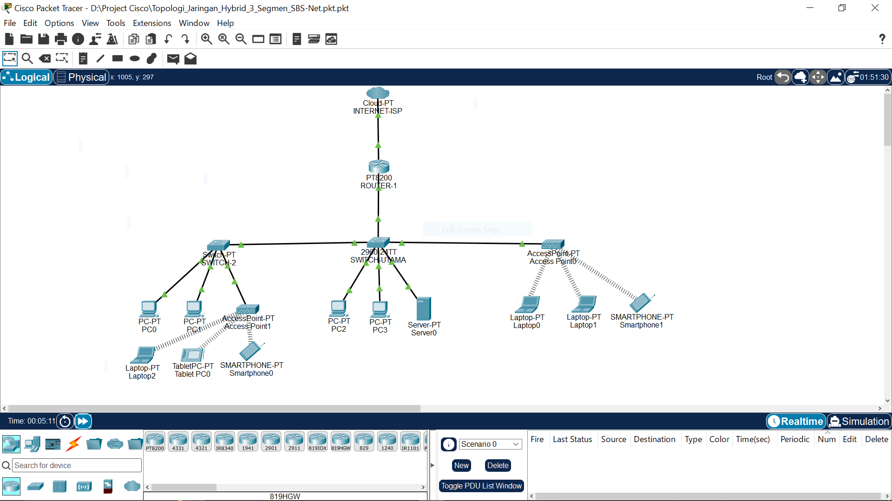

---
*Kontribusi ku dimakan ular, tapi koneksi Cisco ku anti RTO 🐍🌐*
### 👋 Tentang Aku

Halo! Aku **Satria Bagas Sejati (552012610009)** - Mahasiswa Teknik Informatika.

Aku lagi fokus belajar membangun **clean code selangkah demi selangkah** di dunia C++ (Struktur Data & Algoritma) dan juga mendalami dunia Networking lewat Cisco Packet Tracer.

> Karena repository ku ada C++ nya dan ada Cisco nya juga, jadi aku belajar di dua dunia sekaligus. Logic & Connection! 🔥

**Nama         :** Satria Bagas Sejati  
**NIM          :** 552012610009  
**Program Studi:** Teknik Informatika  
**Tools        :** Cisco Packet Tracer

Repositori kumpulan simulasi jaringan selama Semester 1. Dibuat untuk mendokumentasikan pembelajaran topologi LAN, Hybrid, VLAN, dan Routing.

### 📁 Daftar Topologi

| No | Nama Topologi | Jenis | File | Status |
| :--- | :--- | :--- | :--- | :--- |
| 01 | Topologi Jaringan Hybrid 3 Segmen SBS-Net | Hybrid (Wired + Wireless) + ISP | `Topologi_Jaringan_Hybrid_3_Segmen_SBS-Net.pkt` | ✅ Connected |
| 02 | Enterprise Office Network Infrastructure | Enterprise Full (VLAN, Trunking, DHCP, WiFi) | `enterprise-office-network.pkt` | ✅ Connected |
| 03 | (Project Selanjutnya) | - | - | ⏳ Coming Soon |

### 🖼️ Preview Project 01 - Hybrid 3 Segmen SBS-Net

**Fitur Project 01:**
- 1x Cloud / ISP
- 1x Router PT1200
- 2x Switch 2960
- 2x Access Point
- PC, Laptop, Server, Smartphone, Tablet

### 🖼️ Preview Project 02 - Enterprise Office (All Green)

**Fitur Project 02 (Pengembangan dari Project 01):**
- **Topologi:** ISP Cloud -> R1-Core Router (2911) -> Switch Utama (2960) -> 3 Access Switch (IT/HRD/Finance) + AP + Server
- **4 VLAN:** VLAN 10 IT (192.168.10.0/24), VLAN 20 HRD (192.168.20.0/24), VLAN 30 Finance (192.168.30.0/24), VLAN 40 Server-WiFi (192.168.40.0/24)
- **Core Tech:** 802.1Q Trunking, Inter-VLAN Routing (Router-on-a-Stick), Centralized DHCP Pool, WPA2-PSK
- **Device:** 9 PC Kabel + 6 Laptop + 2 Smartphone + 1 Server
- **Verifikasi:** Semua segitiga hijau, ping cross-VLAN & wired to wireless OK

### 🛠️ Tools
- Cisco Packet Tracer 8.2+
- Focus: VLAN, Trunking, Inter-VLAN Routing, DHCP & WLAN

---
**By:** 552012610009 | SBS-Net Lab

*Semester 1 - Teknik Informatika 2026*

